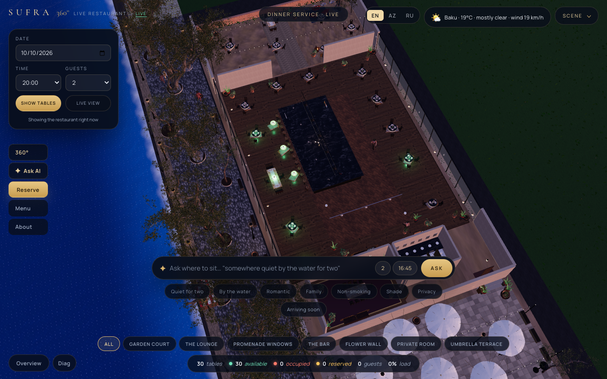
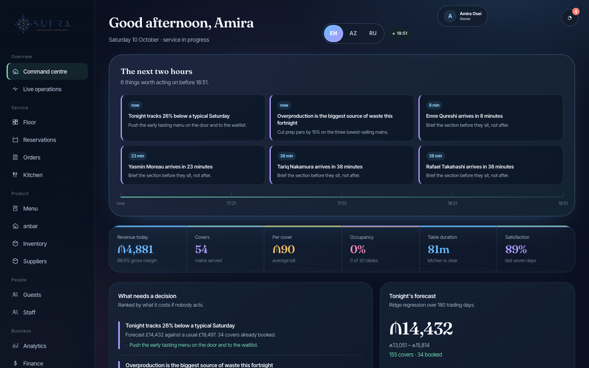
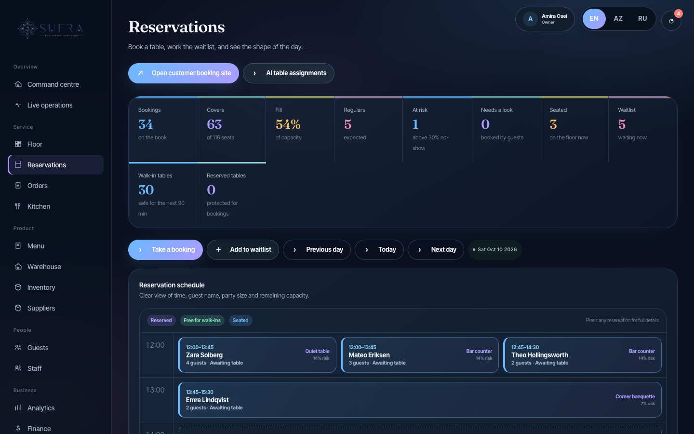
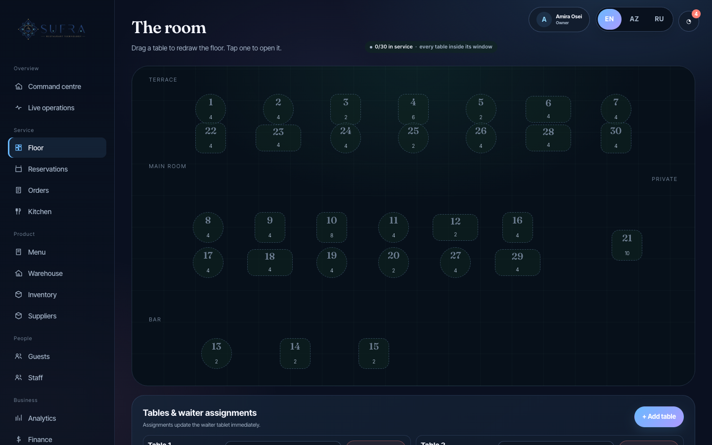
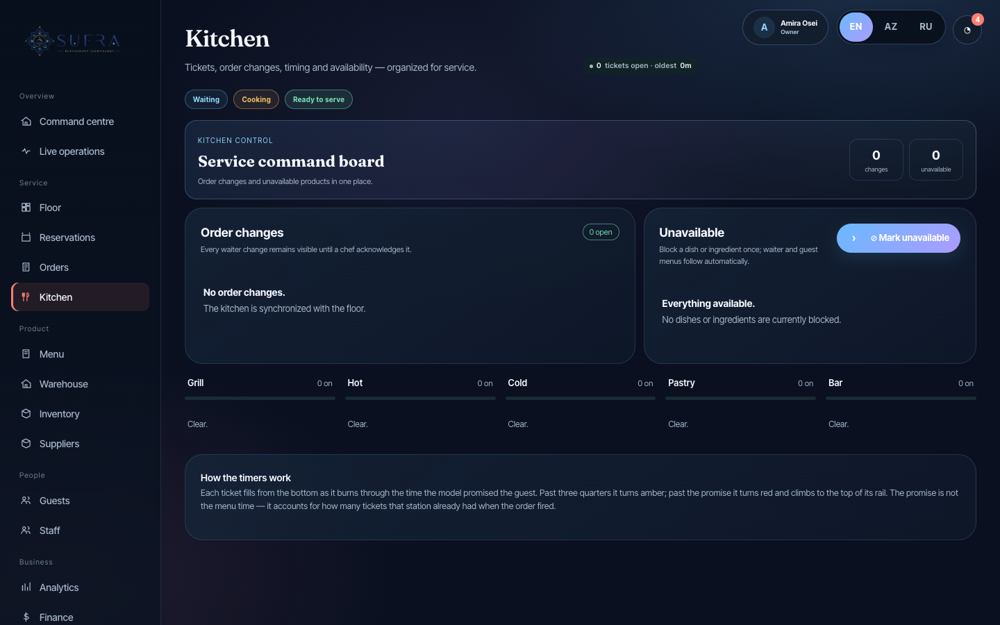
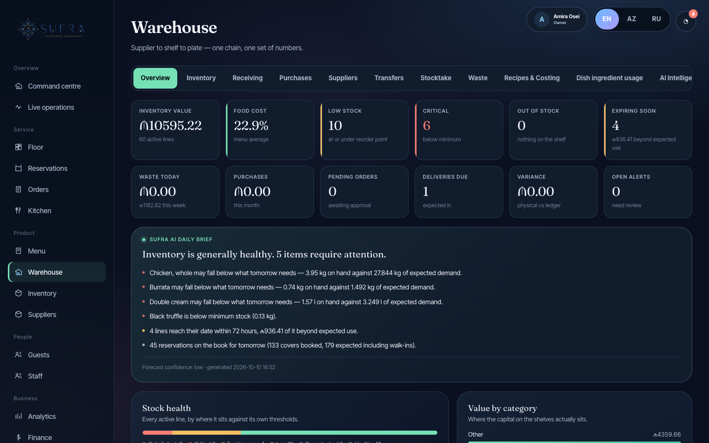
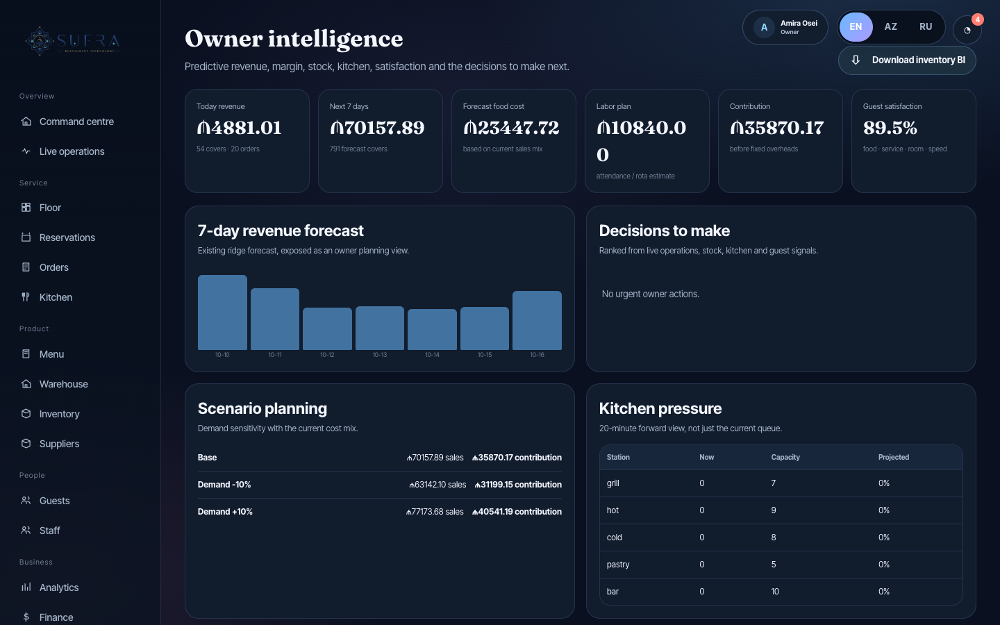
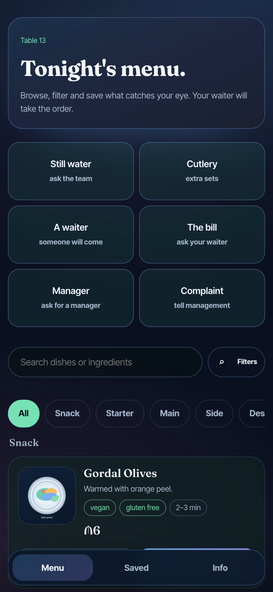
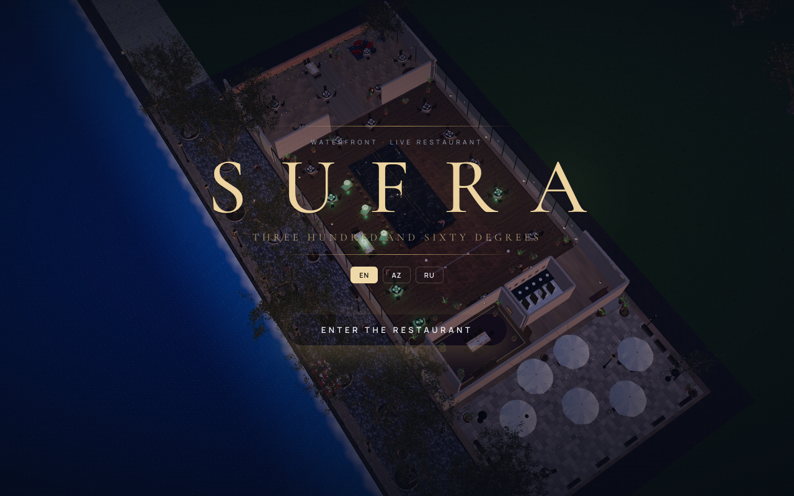
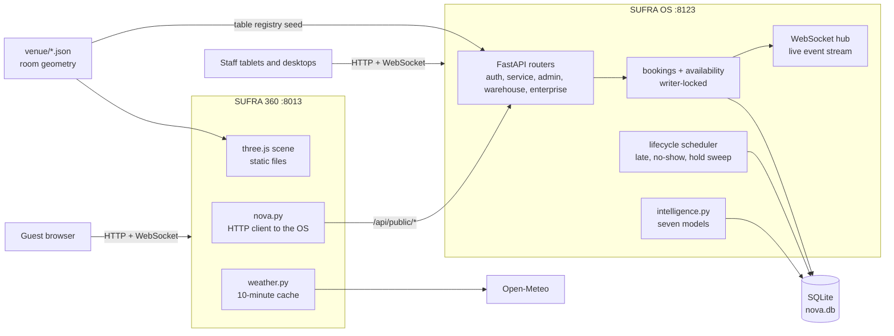

# SUFRA — Restaurant Platform

[](https://github.com/madmaxfv0/sufra-restaurant-platform/actions/workflows/ci.yml)

SUFRA is a restaurant management system in two connected applications. **SUFRA OS** is what staff use: reservations, floor, orders, kitchen display, menu, warehouse, HR, accounting and analytics. **SUFRA 360** is what guests see: a live 3D model of the venue where they can check which tables are free, choose one and book it.

Both run against one source of truth. SUFRA 360 holds no restaurant data of its own; every table, booking and menu item is read from and written to SUFRA OS.



## Problem and purpose

Restaurants usually run reservations, the point of sale, the kitchen screen, stock and staff rotas in separate tools, with a booking widget on the website that knows nothing about the floor. Guests pick a time, not a table, and managers reconcile the systems by hand.

SUFRA puts those workflows on one database with one identifier per table, and lets the guest-facing side show the real room. A guest who books table 8 in the 3D view takes the same table 8 the host sees on the floor plan, and the booking appears on the manager's screen as it is made.

## Project status

**Working prototype.**

- Runs locally from one command with a seeded, entirely synthetic restaurant ("SUFRA Waterfront").
- A demo of the guest side is deployed at [sufra-360.fly.dev](https://sufra-360.fly.dev), backed by a hosted SUFRA OS instance.
- It has not been used by a real restaurant. There are no real customers, orders or payments in it.
- "NOVA" was the working name of SUFRA OS. It survives in a few identifiers such as `nova.db` and `NOVA_DB_PATH`.

## Screenshots

All screenshots are from a local run on the seeded demo data. The 3D views were captured in a headless browser with software rendering, so a normal browser with a GPU looks sharper.

| | |
|---|---|
|  Command centre: what needs a decision in the next two hours |  Reservations |
|  Floor plan |  Kitchen display |
|  Warehouse and stock intelligence |  Owner intelligence |
|  Guest menu opened from a table QR code |  SUFRA 360 entrance view |

More in [docs/screenshots](docs/screenshots).

## Main features

**SUFRA OS (staff)**

- **Reservations and seating** — availability by date, time and party size; five-minute table holds; a booking lifecycle with late and no-show automation; a waitlist ([`sufra-os/app/bookings.py`](sufra-os/app/bookings.py), [`availability.py`](sufra-os/app/availability.py), [`lifecycle.py`](sufra-os/app/lifecycle.py)).
- **No double bookings** — every check-then-write on a table runs inside SQLite's writer lock, across processes ([`dblock.py`](sufra-os/app/dblock.py)). Twelve simultaneous requests for one table produce exactly one booking; see [Testing](#testing-and-evaluation).
- **Waiter app** — table workspace, order pad with seats, courses and modifiers, allergy notes, bill splitting ([`routers/service_api.py`](sufra-os/app/routers/service_api.py)).
- **Kitchen display** — tickets by station with preparation states and allergen checks against what each guest declared ([`allergens.py`](sufra-os/app/allergens.py)).
- **QR table ordering** — a per-table link and printable QR grid that opens the menu for that table.
- **Warehouse** — stock ledger, purchasing, goods receipts, transfers, stocktakes, waste, recipes and costing, with recipe-based consumption posted from kitchen tickets ([`anbar.py`](sufra-os/app/anbar.py), [`routers/anbar.py`](sufra-os/app/routers/anbar.py)).
- **Analytics** — seven statistical models: revenue forecast (ridge regression), preparation time, station pressure, inventory outlook, no-show risk (logistic scoring), menu engineering and service risk ([`intelligence.py`](sufra-os/app/intelligence.py)).
- **HR and accounting** — employee profiles, attendance, leave, a gross payroll estimate; a chart of accounts, journals, trial balance and P&L generated from operational entries ([`routers/enterprise.py`](sufra-os/app/routers/enterprise.py)).
- **Access control** — PIN sign-in with PBKDF2 hashing and escalating lockout, nine roles, a server-side permission matrix, QR staff badges, optional passkeys ([`security.py`](sufra-os/app/security.py), [`permissions.py`](sufra-os/app/permissions.py)).
- **Three languages** — English, Azerbaijani and Russian across staff and guest screens.

**SUFRA 360 (guests)**

- **Live 3D venue** — a three.js scene of the restaurant in which each table's lantern shows its status: free, occupied, or reserved soon ([`sufra-360/static/js/sufra360/`](sufra-360/static/js/sufra360)).
- **Book from the room** — choose a date, time and party size, see which tables are bookable, hold one and reserve it.
- **Weather-driven scene** — current Baku conditions from Open-Meteo drive wind, cloud, rain and time of day ([`sufra-360/app/weather.py`](sufra-360/app/weather.py)).
- **Table guide** — a free-text request such as "quiet table by the water for two" is matched against table attributes and ranked.

What each feature does and does not do is set out in [docs/features.md](docs/features.md).

## Technology stack

| Technology | Role |
|---|---|
| Python 3.12, FastAPI, Uvicorn | Both applications' servers. |
| SQLModel / SQLAlchemy, SQLite (WAL) | SUFRA OS data layer. PostgreSQL is supported through `DATABASE_URL` but was not tested here. |
| Jinja2, vanilla JavaScript, CSS | SUFRA OS screens. No frontend build step. |
| WebSockets | Live updates to staff screens and to the 3D scene. |
| NumPy | The forecasting and scoring models. |
| three.js r170 (vendored), GLSL shaders | The 3D venue: instanced models, water, foliage, rain. |
| `qrcode`, `cryptography` (Fernet) | Table QR codes and encrypted staff badges. |
| Pillow, Blender (Python scripts) | Generated artwork and the 3D asset preparation pipeline. |
| Docker, Fly.io, Kubernetes manifests | Deployment. |
| `unittest`, Playwright, GitHub Actions | Tests and CI. |

## Architecture



SUFRA 360 polls the OS's revision counter and pushes a state message to its own WebSocket clients when it changes. More detail: [docs/architecture.md](docs/architecture.md).

## Quick start

Requirements: Python 3.12 (3.11 should work; 3.12 is what was tested). No Node, no database server.

```bash
scripts/start_demo.sh
```

This creates `.venv`, installs the pinned dependencies, seeds a demo database and starts both applications:

| Application | URL |
|---|---|
| SUFRA OS: launcher for the admin, waiter and guest apps | <http://127.0.0.1:8123> |
| SUFRA 360: 3D venue | <http://127.0.0.1:8013> |

**Signing in.** The first run prints a table of demo staff and their PINs to the terminal. That printout is the only place they appear. To see it again, stop the script, delete `sufra-os/nova.db` and start again. Roles and what each can do are in [docs/demo-guide.md](docs/demo-guide.md).

To run the pieces yourself:

```bash
python3 -m venv .venv && source .venv/bin/activate
```

```bash
pip install -r sufra-os/deploy/requirements.lock
```

```bash
cd sufra-os && NOVA_SEED_DEMO=1 python start_all.py
```

```bash
cd sufra-360 && python run.py
```

Use `deploy/requirements.lock`, not `requirements.txt`: a fresh resolve of the looser ranges installs a newer SQLModel that the application does not yet support.

Configuration is optional; see [docs/configuration.md](docs/configuration.md) and [`.env.example`](.env.example).

## Example workflow

1. Open SUFRA 360, enter the restaurant, choose a date, 20:00 and two guests, and press **Show tables**. Bookable tables are lit.
2. Click a table, review it, and reserve. The table is held for five minutes while you fill in your details, then confirmed with a booking code.
3. In SUFRA OS, sign in to the admin app as a manager. The booking is in **Reservations**, marked as arriving from SUFRA 360 and waiting for the restaurant to accept or decline it.
4. On the evening, the host seats the party from **Floor**; the table's lantern in the 3D view turns red for every guest looking at the room.
5. A waiter signs in on a tablet, opens the table, takes the order by seat and sends the first course. Tickets appear on the **Kitchen** display by station, and moving a ticket into preparation posts its recipe quantities to the warehouse ledger.
6. The bill is split and recorded in the waiter app. Revenue, covers and stock movements feed **Analytics**, **Warehouse** and **Accounting**.

## Engineering decisions

| Decision | Why | Trade-off |
|---|---|---|
| SUFRA 360 has no database | One source of truth for tables and bookings; the two apps cannot disagree. | The 3D app is unusable when the OS is down, and says so. |
| `BEGIN IMMEDIATE` around every booking decision | The availability check and the insert that relies on it cannot interleave with another request, even from another process. | Writes are serialised. Fine for one restaurant; PostgreSQL would use transaction isolation instead. |
| Availability and live occupancy are separate functions | "Someone is sitting there now" must not answer "can it be booked at nine?". | Two code paths to keep consistent. |
| One scheduler, in the OS only | A reservation can never be marked late or no-show twice. | The OS must stay running; the Fly configuration keeps one machine always on. |
| Models, not a language model, behind the "copilot" | Every figure is computed from the database and can be explained. | Questions are routed by rules, so phrasing outside the expected patterns gets a generic answer. |
| Server-rendered pages and plain JavaScript | No build step; the whole system starts from Python. | Large hand-written scripts and layered stylesheets. |
| Additive schema migration at start-up | An existing database keeps its history when the code moves forward. | Two ways a column can come to exist; this hid a bug that only appeared on a brand-new database (fixed, see [docs/repository-cleanup.md](docs/repository-cleanup.md)). |
| Venue geometry as JSON | The room can be replaced without touching the booking engine. | The shipped layout is designed, not measured from a real building. |

## Testing and evaluation

Run from `sufra-os/`, with the virtual environment active:

```bash
python -m unittest discover -s tests
```

18 unit tests on temporary databases: staff QR badges and PIN rules, session revocation, and warehouse recipe quantities, unit conversion and repeat-posting protection.

With the demo running:

```bash
python tests/http_double_booking.py
```

Fires 12 simultaneous requests from separate guest sessions for one table and slot, for holds and then for reservations, and requires exactly one of each to succeed. Result on the seeded demo: 1 hold granted and 11 refused; 1 reservation created and 11 refused.

Browser tests (need `pip install playwright httpx` and `python -m playwright install chromium`):

```bash
PYTHONPATH=. python tests/browser_staff_qr.py
```

```bash
PYTHONPATH=. python tests/browser_warehouse.py
```

```bash
PYTHONPATH=. python tests/browser_qr_full_app.py
```

All three passed against the seeded demo when this repository was prepared.

Not covered by automated tests: the waiter ordering flow, kitchen display, accounting and HR screens, the analytics models' accuracy, the 3D scene, PostgreSQL mode, and the Docker and Kubernetes deployments. Details in [docs/testing.md](docs/testing.md).

## Limitations and roadmap

**Current limitations**

- **Payments are recorded, not processed.** The payment screen stores a method (card, Apple Pay, Google Pay, cash, QR) and an amount. No payment provider is integrated and no card data is handled.
- **No language model is integrated.** The "AI Copilot" and "Ask AI" features are rule-based routing over the statistical models and the table attributes. The only optional model call is OpenAI image generation for a menu photo when `OPENAI_API_KEY` is set.
- **Some read-only endpoints are open.** `/api/floor`, `/api/kitchen`, `/api/reservations`, `/api/inventory`, `/api/snapshot`, `/api/insights` and `/api/forecast` answer without a staff token. Write endpoints and the admin, warehouse, HR and accounting APIs require one.
- **No guest messaging.** Confirmation emails and SMS were removed; a booking is confirmed on screen only.
- **Single instance.** SQLite and an in-process WebSocket hub mean one OS process. Horizontal scaling would need PostgreSQL and a shared pub/sub.
- **Payroll and accounting are operational estimates**, not statutory payroll or a ledger of record.
- **Model quality is unmeasured on real data.** The forecast and risk models are fitted to seeded history.
- **Some 3D assets are not in the repository** for licensing reasons; the scene falls back to open-licensed models ([asset credits](sufra-360/static/3d/ASSET_CREDITS.md)).

**Possible next steps**

- Put the remaining read endpoints behind authentication.
- Integrate a payment provider in test mode.
- Move the live event stream to a shared broker and test PostgreSQL mode.
- Automated tests for the ordering and kitchen flows.

## Documentation

| Document | Contents |
|---|---|
| [docs/architecture.md](docs/architecture.md) | Components, data flow, concurrency, live updates, data model |
| [docs/features.md](docs/features.md) | Each feature, where it lives in the code, and its limits |
| [docs/api-reference.md](docs/api-reference.md) | Public booking API with examples; route groups |
| [docs/roles-and-permissions.md](docs/roles-and-permissions.md) | Authentication, the nine roles, the permission matrix |
| [docs/demo-guide.md](docs/demo-guide.md) | Running the demo, demo roles, safety notes |
| [docs/configuration.md](docs/configuration.md) | Environment variables and external services |
| [docs/testing.md](docs/testing.md) | What is tested and how |
| [docs/deployment.md](docs/deployment.md) | Fly.io deployment of both applications |
| [docs/staff-qr-access.md](docs/staff-qr-access.md) | Staff QR badges |
| [docs/warehouse-usage.md](docs/warehouse-usage.md) | Warehouse recipes and stock usage |
| [docs/enterprise-modules.md](docs/enterprise-modules.md) | HR, accounting, BI endpoints, passkeys |
| [docs/capturing-a-venue.md](docs/capturing-a-venue.md) | Replacing the designed venue with a measured one |
| [docs/repository-cleanup.md](docs/repository-cleanup.md) | What changed when this repository was prepared |

## Authorship and acknowledgements

Author: **Fakhriyya Vazirova**. Development used AI coding assistance.

Third-party material:

- **3D models, textures and HDRIs** — Khronos glTF Sample Assets, Poly Haven, Kenney, Sara Vieira, ambientCG and Quaternius, under CC0 or CC BY 4.0. Each file is listed with its licence in [`sufra-360/static/3d/ASSET_CREDITS.md`](sufra-360/static/3d/ASSET_CREDITS.md).
- **Menu photographs** — Wikimedia Commons contributors under CC BY and CC BY-SA licences, listed in [`sufra-360/assets/menu/PHOTO_CREDITS.txt`](sufra-360/assets/menu/PHOTO_CREDITS.txt).
- **Libraries** — three.js and three-mesh-bvh (MIT), jsQR (Apache 2.0), and the Python packages in [`sufra-os/deploy/requirements.lock`](sufra-os/deploy/requirements.lock).
- **Services called at run time** — Open-Meteo (weather), MyMemory and Google Translate (interface translation, cached), Google Maps embeds.

Staff, guests, suppliers and bookings in the demo are generated; any resemblance to real people is coincidental.

No licence has been chosen for this repository.
